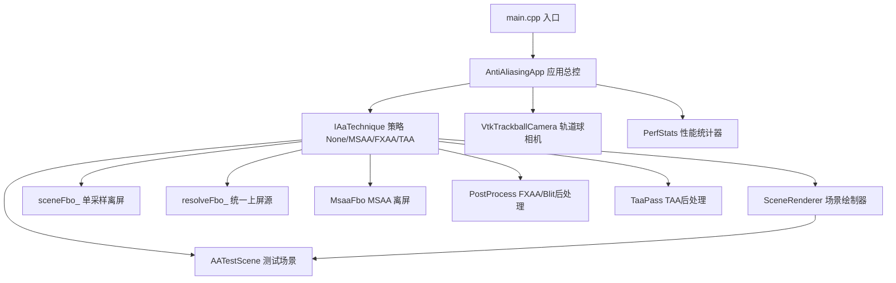
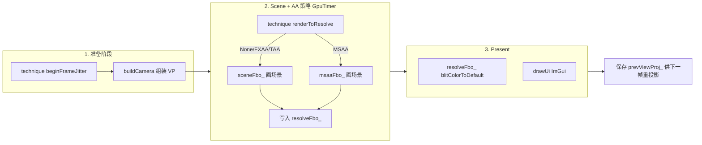

# OpenGL 抗锯齿对比框架 (OpenGL_Anti_Aliasing) 完整技术大纲与全景 README

> 源码地址：[GitHub 仓库](https://github.com/HalCG/OpenGLInstance/tree/main/OpenGL_Anti_Aliasing)  
> 本文档为 `OpenGL_Anti_Aliasing` 子项目的**完整技术大纲与工程指南**，全量整合了总体架构设计、四种 AA 算法数学与 Shader 实现、代码导读地图、核心问答集锦 (Q1~Q15)、RenderDoc 典型排查实录以及附录对比表。

---

## 目录

1. [项目动机与设计原则](#1-项目动机与设计原则)
2. [总体架构与模块关系](#2-总体架构与模块关系)
3. [目录结构与各文件职责](#3-目录结构与各文件职责)
4. [程序生命周期与主循环时序](#4-程序生命周期与主循环时序)
   - 4.1 启动初始化链 (`init`)
   - 4.2 主循环策略 (`run`：每帧 poll + render)
   - 4.3 单帧执行 12 步详解 (`renderFrame`)
   - 4.4 [`createAaTechnique` 与 `std::make_unique`](#44-createaatechnique-与-stdmake_unique)
5. [核心状态变量地图](#5-核心状态变量地图)
6. [测试场景设计 (AATestScene)](#6-测试场景设计-aatestscene)
7. [离屏 FBO 架构与深度格式](#7-离屏-fbo-架构与深度格式)（含 §7.3 Blit vs Resolve）
8. [四种抗锯齿 (AA) 模式与 Shader 深入剖析](#8-四种抗锯齿-aa-模式与-shader-深入剖析)
   - 8.1 [None (无 AA 基线)](#81-none-无-aa-基线)
   - 8.2 [MSAA (硬件多重采样与 Resolve 机制)](#82-msaa-硬件多重采样与-resolve-机制)
   - 8.3 [FXAA (后处理感知亮度与 `fxaa.frag` 边缘切线探测)](#83-fxaa-后处理感知亮度与-fxaafrag-边缘切线探测)
   - 8.4 [TAA (时间复用、Halton 抖动、`taa.frag` 3x3 AABB Clamping 与重投影)](#84-taa-时间复用halton-抖动taafrag-3x3-aabb-clamping-与重投影)
   - 8.5 [GLSL 函数参数限定符 `in` / `out` / `inout`](#85-glsl-函数参数限定符-in--out--inout)（与 C++ 引用差异）
   - 8.6 [jitter VP 与透视除法 `/w`（重投影坐标链）](#86-jitter-vp-与透视除法-w重投影坐标链)
   - 8.7 [TAA 输入缓冲与 history Ping-Pong](#87-taa-输入缓冲与-history-ping-pong)
9. [性能统计与 GpuTimer (`PerfStats`)](#9-性能统计与-gputimer-perfstats)
10. [源码推荐阅读路线](#10-源码推荐阅读路线)
11. [技术深度问答集锦 (Q1 ~ Q15)](#11-技术深度问答集锦-q1--q15)
12. [RenderDoc 典型踩坑与排查实录](#12-renderdoc-典型踩坑与排查实录)
13. [附录：多维对比表、观察指南、工程坑点与构建运行](#13-附录多维对比表观察指南工程坑点与构建运行)

---

## 1. 项目动机与设计原则

### 1.1 要解决的问题
在实时 3D 渲染中，几何体边缘、细小网格和高频纹理会在屏幕像素网格上产生严重的 **锯齿（Aliasing）** 与 **走样闪烁**。工业界提出了多种不同维度的抗锯齿方案，各自在计算开销、显存占用和画面质量上作出了权衡。

本 Demo 的目标是在 **同一场景、同一套前向渲染 Pass** 下，支持运行时通过按键实时切换四种典型抗锯齿方案，进行直观的画面品质与性能对比：

| 模式 | 按键 | 方案类型 | 核心思想 |
| :--- | :--- | :--- | :--- |
| **None** | `1` / `F1` | 无 AA (基线) | 场景渲染到单采样离屏 FBO 后直接 blit 输出到屏幕 |
| **MSAA** | `2` / `F2` | 硬件几何 AA | 硬件多重采样 FBO 渲染，离屏 resolve 合成出屏 |
| **FXAA** | `3` / `F3` | 屏幕后处理 AA | 依赖感知亮度 (Luma) 检测图像强对比边缘并沿切线模糊 |
| **TAA** | `4` / `F4` | 时间复用 AA | 相机子像素抖动 (Halton Jitter) + 历史帧重投影与 AABB Color Clamping 混合 |

### 1.2 三条核心设计原则

1. **Scene Pass 统一**：
   四种模式共用相同的场景模型（`AATestScene`）与绘制逻辑（`SceneRenderer`），确保对比的是**抗锯齿手段本身的优劣**，而非不同的渲染路径。
2. **独立离屏 FBO 管理**：
   默认窗口 FBO 禁用 GLFW MSAA 采样点（`GLFW_SAMPLES = 0`）。所有渲染均在独立的离屏 FBO（`SingleSampleFbo` 或 `MsaaFbo`）中完成，以便精准保留 `Color` 和 `Depth` 纹理供 TAA/FXAA 使用。
3. **公平对比与可观测性**：
   - 标题栏与控制台输出 `scene_ms` / `post_ms`，分离几何与后处理开销；
   - 测试场景包含：高对比棋盘地板 + 多实例 DamagedHelmet（曲面轮廓便于对比几何边锯齿）。

---

## 2. 总体架构与模块关系

### 2.1 模块依赖关系



### 2.2 一帧数据流水线



---

## 3. 目录结构与各文件职责

```
OpenGL_Anti_Aliasing/
├── CMakeLists.txt              # CMake 构建配置文件
├── main.cpp                    # 程序入口：init → run → shutdown
├── include/
│   ├── AntiAliasingApp.hpp     # 应用总控制类：状态、主循环、GLFW 输入、drawUi
│   ├── AaTechnique.hpp         # IAaTechnique / AaFrameContext / createAaTechnique
│   ├── AppConfig.hpp           # 窗口/相机/MSAA 常量配置与资源路径解析
│   ├── RenderTypes.hpp         # AAMode 枚举、FrameCamera、FrameStats 结构体声明
│   ├── VtkTrackballCamera.hpp  # VTK 风格轨道球相机（yaw/pitch/radius 交互）
│   ├── AATestScene.hpp         # 测试场景：棋盘地板 + DamagedHelmet
│   ├── SceneRenderer.hpp       # Scene Pass 绘制器
│   ├── Framebuffer.hpp         # SingleSampleFbo / MsaaFbo 离屏帧缓冲抽象
│   ├── PostProcess.hpp         # 后处理：全屏 Quad、Blit、FXAA
│   ├── TaaPass.hpp             # TAA：历史帧 Ping-Pong 与着色器调用
│   └── PerfStats.hpp           # GPU Query 计时 + CPU 帧时间平滑
├── src/                        # 对应头文件的 C++ 实现（含 AaTechnique.cpp）
└── resources/
    ├── shaders/
    │   ├── scene.vert / scene.frag
    │   ├── fxaa.frag / taa.frag / blit.frag
    │   └── fullscreen.vert
    └── models/DamagedHelmet/   # DamagedHelmet.gltf + albedo 等贴图
```

---

## 4. 程序生命周期与主循环时序

### 4.1 启动初始化链 (`init`)
```
main()
  └─ AntiAliasingApp::init()
       ├─ initWindow()          GLFW 窗口创建、GLAD 加载、注册 Key/Mouse 回调
       ├─ scene_.init()         加载 DamagedHelmet、棋盘地板
       ├─ sceneRenderer_.init() 编译 scene.vert/frag
       ├─ postProcess_.init()   初始化全屏 Quad VAO 与 fxaa.frag/blit.frag
       ├─ taaPass_.init()       初始化 taa.frag 与双历史帧 Texture
       ├─ perf_.scenePass/postPass.init()  初始化 GPU Timer Query 对象
       ├─ resizeTargets()      根据窗口实际像素宽高分配 FBO 与 TAA 历史纹理
       └─ setMode(MSAA)        创建默认 IAaTechnique 并 onEnter
```

### 4.2 主循环策略 (`run`：每帧 poll + render)
当前实现采用**每帧固定出帧**（不再用 `cameraDirty_` / `glfwWaitEvents` 省电门控），原因：

1. **TAA 必须持续出帧**：Halton 抖动与 history 混合在静止机位下也要按帧推进，否则抗锯齿不收敛；
2. **ImGui / 交互一致性**：控制面板、模式切换、VSync 提示与相机拖拽都依赖稳定的每帧 `NewFrame`；
3. **功耗靠 VSync 约束**：默认 `vsyncEnabled_ = true`（`glfwSwapInterval(1)`），避免关 VSync 时无上限打满 GPU。

```cpp
void AntiAliasingApp::run() {
    while (!glfwWindowShouldClose(window_)) {
        glfwPollEvents();   // 先取输入，本帧 buildCamera 立即用上
        renderFrame();      // 策略写 resolve → blit 上屏 → drawUi
        glfwSwapBuffers(window_);
    }
}
```

### 4.3 单帧执行 12 步详解 (`renderFrame`)

| 步骤 | 代码位置 | 核心动作 |
|------|----------|--------|
| **1** | `perf_.beginFrame()` | 记录 CPU 起始时间戳 |
| **2** | `technique_->beginFrameJitter(ctx)` | TAA：Halton 子像素偏移；其它模式返回 `(0,0)` |
| **3** | `buildCamera(jitter)` | 组装 view / projection / VP / invVP（重投影用 unjittered） |
| **4** | `scenePass.begin()` | 开启 Scene Pass GPU Timer Query 计时 |
| **5** | `technique_->renderToResolve(...)` | 策略内完成场景绘制 + AA，最终颜色写入 `resolveFbo_` |
| **6** | `scenePass.endMs()` | 停止 Scene Pass 计时并回读 `scenePassMs` |
| **7** | `postPass.begin()` | 开启 Present Pass GPU 计时 |
| **8** | `resolveFbo_.blitColorToDefault` | 按窗口分辨率把统一结果 blit 到默认帧缓冲 |
| **9** | `postPass.endMs()` | 停止 Present 计时并回读 `postPassMs` |
| **10** | 保存 `prevViewProj_` | 保存本帧 **unjittered** VP，供下一帧 TAA 重投影 |
| **11** | `perf_.endFrame()` | 计算 CPU 帧时间与 1s 窗平滑 FPS |
| **12** | `drawUi()` | ImGui 控制面板（模式 / MSAA / Scale / VSync / 性能） |

### 4.4 `createAaTechnique` 与 `std::make_unique`

按键切换 AA 时，`setMode` 调用工厂函数换掉当前策略对象：

```cpp
technique_ = createAaTechnique(mode); // unique_ptr 赋值会释放旧策略
```

`createAaTechnique` 内部按模式返回对应实现，例如：

```cpp
return std::make_unique<TaaAa>();
```

含义分三步：

1. **堆上构造** `TaaAa`；
2. **包进** `std::unique_ptr<TaaAa>`（独占所有权，析构时自动 `delete`）；
3. **返回**时隐式转换为 `std::unique_ptr<IAaTechnique>`（派生 → 基类），供 `technique_->beginFrameJitter` / `renderToResolve` 多态调用。

#### 为何用 `make_unique`，而不是 `unique_ptr(new …)`

下面两种写法**语义接近**，但推荐前者：

```cpp
// 推荐：本工程写法
return std::make_unique<TaaAa>();

// 等价但更啰嗦 / 稍不安全的写法
return std::unique_ptr<IAaTechnique>(new TaaAa());
```

| | `std::make_unique<TaaAa>()` | `std::unique_ptr<IAaTechnique>(new TaaAa())` |
| :--- | :--- | :--- |
| 做什么 | 一次完成「分配 + 构造 + 包进 unique_ptr」 | 先 `new`，再手动交给 `unique_ptr` |
| 异常安全 | 更稳：构造失败时不会留下「裸 `new` 已成功、智能指针尚未接管」的窗口（尤其在多参数、表达式里夹杂其它可能抛异常的调用时） | 在复杂表达式里更容易写出「泄漏窗口」 |
| 写法 | 短，不必写两次类型 / 基类名 | 要显式写 `new` 与目标 `unique_ptr` 类型 |
| 本工程场景 | `setMode` 换策略、返回给 `technique_` | 功能上也能跑，但不必要 |

补充：

- **不是裸指针**：调用方拿到的是带所有权的 `unique_ptr`；`technique_ = ...` 时旧对象自动释放。
- **多态靠基类接口**：`unique_ptr` 指向 `IAaTechnique`，实际对象仍是 `NoneAa` / `MsaaAa` / `FxaaAa` / `TaaAa`。
- **兜底**：`switch` 未命中时同样 `make_unique<NoneAa>()`，避免返回空指针。

---

## 5. 核心状态变量地图

`AntiAliasingApp` 中的成员变量决定了「何时画、画什么、怎么画」：

| 变量 | 类型 | 核心作用 |
|------|------|------|
| `currentMode_` | `AAMode` | **主开关**：`setMode` 时 `createAaTechnique`，决定当前 `technique_` |
| `technique_` | `unique_ptr<IAaTechnique>` | 当前 AA 策略（`createAaTechnique` / `make_unique`，见 §4.4） |
| `msaaPresetIndex_` | `int` | MSAA 采样点倍率（`2x` / `4x`，快捷键 `[` `]` 切换） |
| `camera_` | `VtkTrackballCamera` | 轨道球相机参数（yaw / pitch / radius / target） |
| `prevViewProj_` | `glm::mat4` | 上一帧未抖动的 View-Projection 矩阵（TAA 重投影核心） |
| `hasPrevViewProj_` | `bool` | 上一帧 VP 矩阵是否有效（首帧 / resize / 切模式后为 false） |
| `sceneFbo_` | `SingleSampleFbo` | 单采样离屏 FBO（None / FXAA / TAA 场景目标；与 `AaFrameContext::sceneFbo` 同名） |
| `resolveFbo_` | `SingleSampleFbo` | 当前 AA 最终颜色；统一 blit 上屏 |
| `msaaFbo_` | `MsaaFbo` | 多重采样离屏 FBO（MSAA 模式使用） |
| `postProcess_` | `PostProcess` | 管理 Blit、FXAA 全屏 Pass |
| `taaPass_` | `TaaPass` | 管理 TAA 全屏 Pass、Halton 抖动与双历史纹理 Ping-Pong |
| `perf_` | `PerfStats` | 管理 GPU Timer Query 计时与 CPU 帧率统计 |

---

## 6. 测试场景设计 (AATestScene)

场景刻意收薄，四种 AA 共用同一几何：

1. **棋盘地板**：高频格子；拖相机时利于观察 TAA 收敛/闪烁差异（MSAA 对纹理内走样帮助有限）。
2. **DamagedHelmet ×3**（中央 + 两侧，`DamagedHelmet.gltf`）：曲面轮廓看几何边锯齿（None vs MSAA/FXAA/TAA）。

TAA 侧：Scene 用 jittered projection；`prevViewProj` / 重投影用 **unjittered** VP；拖拽时提高 `blend` 减轻鬼影。切换模式用 `1–4`，最终颜色统一 `resolveFbo_` → `blitColorToDefault` 上屏。

---

## 7. 离屏 FBO 架构与深度格式

离屏 FBO 的设计是抗锯齿对比框架的物理基础：

### 7.1 `SingleSampleFbo` (单采样离屏 FBO)
- **Color Attachment**：`GL_RGBA8` 普通 2D 纹理；
- **Depth Attachment**：`GL_DEPTH_COMPONENT32F` 浮点深度纹理（TAA 重投影依赖）。
- **作用**：None / FXAA / TAA 场景目标；统一的 `resolveFbo_`。

### 7.2 `MsaaFbo` (多重采样离屏 FBO)
- **Color / Depth**：`GL_TEXTURE_2D_MULTISAMPLE`（2x / 4x）。
- **创建**：`glTexImage2DMultisample(..., samples, GL_RGBA8, ...)`。
- **收尾**：`resolveColorTo(resolveFbo)` —— 多样本压成单采样后再上屏。

### 7.3 Blit 与 Resolve 的区别（同 API、不同语义）

两者在本工程里都调用 `glBlitFramebuffer(... GL_COLOR_BUFFER_BIT, GL_NEAREST)`，差别只在 **READ 附件类型**：

| | `SingleSampleFbo::blitColorTo` | `MsaaFbo::resolveColorTo` |
| :--- | :--- | :--- |
| 源纹理 | `GL_TEXTURE_2D`（每像素 1 色） | `GL_TEXTURE_2D_MULTISAMPLE`（每像素 N 子采样） |
| 驱动行为 | **原样拷贝**（可缩放） | **硬件 Resolve**：N 子采样合成 1 色 |
| 是否产生 AA | 否 | 是（MSAA 收尾） |
| 典型用法 | scene → `resolveFbo_`；`resolveFbo_` → 窗口 | `msaaFbo_` → `resolveFbo_` |

命名拆开是为了读代码立刻知道源是不是 MSAA，不是两套不同的 OpenGL 函数。

```cpp
// blit：单采样搬家
sceneFbo_.blitColorTo(resolveFbo_.fbo(), w, h);

// resolve：MSAA 收尾（同样是 glBlitFramebuffer）
msaaFbo_.resolveColorTo(resolveFbo_.fbo(), w, h);
```

---

## 8. 四种抗锯齿 (AA) 模式与 Shader 深入剖析

### 8.1 None (无 AA 基线)
- **原理**：几何体光栅化时仅对像素中心点做一次采样。
- **管线流程**：场景画入 `sceneFbo_` $\rightarrow$ blit 到 `resolveFbo_` $\rightarrow$ 再 `blitColorToDefault` 上屏（策略类 `NoneAa`）。

### 8.2 MSAA (硬件多重采样抗锯齿)
- **原理**：光栅阶段对每个像素 $N$ 个子采样点算覆盖率/深度；片元着色通常仍按像素执行一次。
- **Resolve**（当前代码，写入统一 `resolveFbo_` 再上屏）：
  ```cpp
  void MsaaFbo::resolveColorTo(GLuint drawFbo, int dstW, int dstH) const {
      glBindFramebuffer(GL_READ_FRAMEBUFFER, fbo_);       // MULTISAMPLE
      glBindFramebuffer(GL_DRAW_FRAMEBUFFER, drawFbo);  // 单采样目标
      glBlitFramebuffer(0, 0, width_, height_, 0, 0, dstW, dstH,
                        GL_COLOR_BUFFER_BIT, GL_NEAREST); // 触发硬件 Resolve
  }
  ```
- **局限**：主要修几何边；纹理内部 / shader 走样基本不管。

### 8.3 FXAA (快速近似抗锯齿与 `fxaa.frag`)
- **原理**：基于图像后处理，利用心理学感知亮度检测强对比度边缘并沿着切线方向双向模糊。
- **亮度公式**：$L = 0.299R + 0.587G + 0.114B$（绿色权重最高，符合人眼感知）。
- **`resources/shaders/fxaa.frag` 完整代码实现**：

```glsl
#version 430 core
layout (location = 0) out vec4 FragColor;

in vec2 vTexCoord;

uniform sampler2D uInput;
uniform vec2 uTexelSize;

// 心理学感知亮度公式 (Luma / Luminance)
float luma(vec3 c) {
    return dot(c, vec3(0.299, 0.587, 0.114));
}

void main() {
    // 采样中心 M 及东西南北 4 个邻域像素
    vec3 rgbM = texture(uInput, vTexCoord).rgb;
    vec3 rgbN = texture(uInput, vTexCoord + vec2(0.0, uTexelSize.y)).rgb;
    vec3 rgbS = texture(uInput, vTexCoord - vec2(0.0, uTexelSize.y)).rgb;
    vec3 rgbE = texture(uInput, vTexCoord + vec2(uTexelSize.x, 0.0)).rgb;
    vec3 rgbW = texture(uInput, vTexCoord - vec2(uTexelSize.x, 0.0)).rgb;

    float lumaM = luma(rgbM);
    float lumaN = luma(rgbN);
    float lumaS = luma(rgbS);
    float lumaE = luma(rgbE);
    float lumaW = luma(rgbW);
    float lumaMin = min(lumaM, min(min(lumaN, lumaS), min(lumaE, lumaW)));
    float lumaMax = max(lumaM, max(max(lumaN, lumaS), max(lumaE, lumaW)));

    // 比较垂直与水平梯度
    float edgeVert = abs((lumaN + lumaS) - 2.0 * lumaM);
    float edgeHorz = abs((lumaE + lumaW) - 2.0 * lumaM);
    bool horz = edgeHorz >= edgeVert;

    // 沿边缘切线方向采样两点并混合
    vec2 offset = horz ? vec2(uTexelSize.x, 0.0) : vec2(0.0, uTexelSize.y);
    vec3 rgbA = texture(uInput, vTexCoord - offset).rgb;
    vec3 rgbB = texture(uInput, vTexCoord + offset).rgb;
    vec3 result = mix(rgbA, rgbB, 0.5);

    // Luma Clamping 校验：防止过度模糊
    float lumaResult = luma(result);
    result = clamp(result, min(rgbM, result), max(rgbM, result));
    if (lumaResult < lumaMin || lumaResult > lumaMax) {
        result = rgbM;
    }

    FragColor = vec4(result, 1.0);
}
```

### 8.4 TAA (时间抗锯齿与 `taa.frag`)
- **原理**：低差异序列 Halton(2, 3) 抖动投影矩阵 + 深度反推世界坐标重投影 + 3x3 邻域 AABB Color Clamping 消除鬼影。
- **Halton(2, 3) 抖动计算公式**：
  $$\text{jitterX} = \frac{2.0 \cdot \text{HaltonX} - 1.0}{\text{width}}, \quad \text{jitterY} = \frac{2.0 \cdot \text{HaltonY} - 1.0}{\text{height}}$$
- **`resources/shaders/taa.frag` 完整代码实现**：

```glsl
#version 430 core
layout (location = 0) out vec4 FragColor;

in vec2 vTexCoord;

uniform sampler2D uCurrentColor;
uniform sampler2D uCurrentDepth;
uniform sampler2D uHistoryColor;

uniform mat4 uInvViewProj;
uniform mat4 uPrevViewProj;
uniform vec2 uTexelSize;
uniform float uBlendFactor;
uniform bool uHasHistory;

// 【历史帧重投影 (Reprojection)】
vec3 reprojectHistory(vec2 uv, out bool valid) {
    float depth = texture(uCurrentDepth, uv).r;
    vec4 ndc = vec4(uv * 2.0 - 1.0, depth * 2.0 - 1.0, 1.0);
    vec4 world = uInvViewProj * ndc;
    world /= world.w;
    vec4 prevNdc = uPrevViewProj * world;
    prevNdc /= prevNdc.w;
    vec2 prevUv = prevNdc.xy * 0.5 + 0.5;
    valid = prevUv.x >= 0.0 && prevUv.x <= 1.0 && prevUv.y >= 0.0 && prevUv.y <= 1.0;
    return texture(uHistoryColor, prevUv).rgb;
}

// 【邻域 AABB 颜色裁剪 (Neighborhood Color Clamping)】消除鬼影的核心！
vec3 clipHistory(vec3 history, vec3 current) {
    vec3 minC = current;
    vec3 maxC = current;
    for (int x = -1; x <= 1; ++x) {
        for (int y = -1; y <= 1; ++y) {
            vec2 uv = vTexCoord + vec2(float(x), float(y)) * uTexelSize;
            vec3 c = texture(uCurrentColor, uv).rgb;
            minC = min(minC, c);
            maxC = max(maxC, c);
        }
    }
    return clamp(history, minC, maxC);
}

void main() {
    vec3 current = texture(uCurrentColor, vTexCoord).rgb;
    if (!uHasHistory) {
        FragColor = vec4(current, 1.0);
        return;
    }

    bool valid;
    vec3 history = reprojectHistory(vTexCoord, valid);
    if (!valid) {
        FragColor = vec4(current, 1.0);
        return;
    }

    // 执行 3x3 AABB 颜色裁剪防鬼影
    history = clipHistory(history, current);

    // 时间维度指数平滑混合 (默认 uBlendFactor = 0.1)
    vec3 result = mix(history, current, uBlendFactor);
    FragColor = vec4(result, 1.0);
}
```

### 8.5 GLSL 函数参数限定符 `in` / `out` / `inout`（与 C++ 差异）

`taa.frag` 里这段容易按 C++ 习惯误读：

```glsl
vec3 reprojectHistory(vec2 uv, out bool valid) { ... }

bool valid;
vec3 history = reprojectHistory(vTexCoord, valid);
if (!valid) { /* history UV 出屏，放弃混合 */ }
```

在 **C++** 里，`bool` 默认按值传递，函数内赋值改不到调用方，除非写成 `bool&` / 指针。  
在 **GLSL** 里，**值类型本身不能当「引用」**；能否写回调用方，靠参数前的**限定符**：

| 限定符 | 含义 | 近似 C++ | 本工程用法 |
| :--- | :--- | :--- | :--- |
| `in`（可省略） | 只读传入；函数内改动不传出 | 按值 `T` | `vec2 uv` |
| `out` | 只写出；调用前不必初始化；函数内赋值写回调用方 | 近似 `T&` 输出 | `out bool valid` |
| `inout` | 先读入再写出 | 真正的 `T&` | 本 Demo 未用 |

要点：

1. **`out bool valid` 可以把结果传出来**——不是因为 `bool` 是引用类型，而是因为写了 `out`。
2. **`out` 参数在进入函数前值未定义**；函数必须赋值。若还需要读调用方旧值，应改用 `inout`。
3. **片元输出也是同一种机制**：`layout(location = 0) out vec4 FragColor` 的 `out` 表示写到帧缓冲附件，不是「返回值」。
4. **易混的 `in`/`out`**：顶点/片元之间的 `in vec2 vTexCoord` 是**阶段间 varyings**；函数形参上的 `in`/`out` 是**函数调用约定**。名字相同，场景不同。
5. **相关**：`uniform` 是 CPU→GPU 只读常量；`sampler2D` 等纹理句柄一般作 `in`（默认）传入采样函数，不能当普通 `out` 写回。

对照本函数：`return` 带回 history 颜色；`out valid` 额外带回「上一帧 UV 是否仍在屏幕内」。两个结果缺一不可，所以用「返回值 + `out` 参数」，而不是只返回 `vec3`。

### 8.6 jitter VP 与透视除法 `/w`（重投影坐标链）

读 `taa.frag::reprojectHistory` 时，两个概念最容易混：**什么叫 jitter VP**，以及两处 `/= w` 是否一回事。

#### 8.6.1 jitter VP / unjittered VP

**VP** = View-Projection（本工程 `projection * view`）。

| 名称 | 含义 | 谁在用 |
| :--- | :--- | :--- |
| **unjittered VP** | 正常透视投影，像素对准像素中心 | 重投影；帧末写入 `prevViewProj_` |
| **jittered VP** | 在 projection 上加了 Halton **子像素偏移** | 仅 TAA 的 Scene Pass 光栅化 |

CPU 侧（`AntiAliasingApp::buildCamera`）：

```cpp
camera.unjitteredViewProjection = baseProj * camera.view;           // 始终无 jitter
camera.invUnjitteredViewProjection = glm::inverse(...);             // 交给 uInvViewProj
camera.projection = baseProj;
if (currentMode_ == AAMode::TAA) {
    camera.projection[2][0] += jitterNdc.x * 2.0f;                  // 只污染「画场景」用的投影
    camera.projection[2][1] += jitterNdc.y * 2.0f;
}
// 帧末：prevViewProj_ = camera.unjitteredViewProjection;         // 下一帧 uPrevViewProj
```

TaaPass 传入 shader 的必须是无 jitter 矩阵：

```cpp
glUniformMatrix4fv(locInvViewProj_, ..., &camera.invUnjitteredViewProjection[0][0]); // uInvViewProj
glUniformMatrix4fv(locPrevViewProj_, ..., &prevViewProj[0][0]);                      // uPrevViewProj
```

若重投影也带 jitter：相机静止时，同一世界点算出的 history UV 仍会每帧漂移 → 闪烁/拖影。

#### 8.6.2 重投影逐步对照（`taa.frag`）

几何链：**本帧屏幕 → 世界 → 上一帧屏幕**。

```glsl
float depth = texture(uCurrentDepth, uv).r;
vec4 ndc = vec4(uv * 2.0 - 1.0, depth * 2.0 - 1.0, 1.0); // [0,1] → NDC [-1,1]
vec4 world = uInvViewProj * ndc;
world /= world.w;                                         // ① 齐次 → 世界笛卡尔点
vec4 prevNdc = uPrevViewProj * world;
prevNdc /= prevNdc.w;                                     // ② 齐次 → 上一帧 NDC
vec2 prevUv = prevNdc.xy * 0.5 + 0.5;                     // NDC → history UV
valid = /* prevUv 是否在 [0,1] */;
return texture(uHistoryColor, prevUv).rgb;
```

| 步 | 代码 | 结果落在哪 |
| :--- | :--- | :--- |
| 1 | 采 `depth` | 本帧该像素深度 |
| 2 | 拼 `ndc` | 本帧裁剪/NDC 齐次坐标 |
| 3 | `× uInvViewProj` 再 `/w` | **世界空间点 P** |
| 4 | `× uPrevViewProj` 再 `/w` | **上一帧 NDC** |
| 5 | `×0.5+0.5` | history 采样 UV；出屏则 `valid=false` |

#### 8.6.3 两处 `/= w`：运算相同，落点不同

都是齐次坐标的**透视除法**（perspective divide）：矩阵乘完得到 `vec4(x,y,z,w)`，笛卡尔坐标为 `(x/w, y/w, z/w)`。

| 代码 | 乘的矩阵 | `/w` 之后 |
| :--- | :--- | :--- |
| `world /= world.w` | 本帧 **unjittered VP 的逆** | 世界空间点 |
| `prevNdc /= prevNdc.w` | 上一帧 **unjittered VP** | 上一帧 NDC（约 [-1,1]） |

不是两套不同的数学，只是「还原世界」与「投回上一帧屏幕」各做一次齐次归一化。

```text
本帧像素 (uv, depth)
      │  inv(本帧 unjittered VP)  + /w
      ▼
   世界空间一点 P
      │  上一帧 unjittered VP  + /w
      ▼
上一帧屏幕位置 → 采 history
```

### 8.7 TAA 输入缓冲与 history Ping-Pong

易混点：`history_[0/1]` **不是**「一张当前帧 color+depth、一张历史色」。双缓冲里存的都是**混合后的颜色**；本帧场景色/深度来自 `sceneFbo`。

#### 颜色路径：读两个、写第三个

| 角色 | 资源 | shader | 内容 |
| :--- | :--- | :--- | :--- |
| 当前 | `sceneFbo.colorTexture()` | `uCurrentColor` | 本帧 Scene 颜色 |
| 历史 | `history_[readIndex]` | `uHistoryColor` | **上一帧** TAA 混合结果（仅颜色） |
| 写出 | `history_[writeIndex]` | FBO 附件 | 本帧 `mix` 后的新结果 |

```text
sceneFbo.color  ──┐
history_[read]  ──┼─→ taa.frag ─→ history_[write]
                  │                    │
sceneFbo.depth  ──┘（只参与重投影）     ▼
                                 下帧变成 read
```

一句话：**把「当前色 + 历史色」混合进第三张（另一路 history）再输出**；下帧读写对调。

#### 深度是第四个输入，不进 Ping-Pong

`uCurrentDepth` 来自 `sceneFbo.depthTexture()`，只用于 `reprojectHistory` 把 UV 还原到世界坐标。  
**不参与 `mix`，也不写入 `history_[]`。**

#### CPU 侧交换（`TaaPass::apply`）

```cpp
const int writeIndex = 1 - currentIndex_;
const int readIndex = currentIndex_;

glFramebufferTexture2D(..., history_[writeIndex], ...); // 本帧写这里
glBindTexture(..., history_[readIndex]);                // uHistoryColor 读上一帧

// ... 画全屏 → taa.frag ...

currentIndex_ = writeIndex; // 帧末对调；outputTexture() 即刚写完的那张
```

为何要双缓冲：同一帧不能对同一张纹理既当 `uHistoryColor` 采样又当 FBO 写出（读写作冲突）。Ping-Pong 拆开读/写槽即可。

---

## 9. 性能统计与 GpuTimer (`PerfStats`)

为了毫秒级精确分离 Scene Pass 与 Post Pass 的显存开销，项目使用 OpenGL `GL_TIME_ELAPSED` 双缓冲区 Query 对象：

```cpp
void GpuTimer::begin() {
    glBeginQuery(GL_TIME_ELAPSED, queries_[queryIndex_]);
}

void GpuTimer::endMs() {
    glEndQuery(GL_TIME_ELAPSED);
    GLuint64 timeElapsed = 0;
    glGetQueryObjectui64v(queries_[1 - queryIndex_], GL_QUERY_RESULT, &timeElapsed);
    lastMs_ = static_cast<float>(timeElapsed) / 1000000.0f;
    queryIndex_ = 1 - queryIndex_; // 异步双缓冲避开 CPU 阻塞
}
```

---

## 10. 源码推荐阅读路线

建议顺着以下文件链路通读工程源码：

```
① main.cpp                      # 了解 3 步生命周期 (init -> run -> shutdown)
 └─► ② RenderTypes.hpp          # 了解 AAMode 枚举与 FrameCamera 数据结构
      └─► ③ AntiAliasingApp.hpp # 查阅核心成员变量地图（sceneFbo_ / resolveFbo_ / technique_）
           └─► ④ AntiAliasingApp.cpp (run / renderFrame)  # 每帧 poll → 策略写 resolve → blit → drawUi
                └─► ⑤ AaTechnique.hpp / AaTechnique.cpp   # 【核心】四种 AA 策略如何写入 resolveFbo_
                     ├─► ⑥ Framebuffer.cpp          # 观察单采样与 MSAA FBO 的创建与 Blit/Resolve 区别
                     ├─► ⑦ PostProcess.cpp & fxaa.frag  # 观察 FXAA 屏幕后处理边缘检测算法
                     └─► ⑧ TaaPass.cpp & taa.frag       # 观察 Halton 抖动、重投影与 AABB Color Clamping 逻辑
```

---

## 11. 技术深度问答集锦 (Q1 ~ Q15)

### Q1. Resolve 和 Blit 有什么区别？
都是 `glBlitFramebuffer`，见 **§7.3**。
* **`blitColorTo`**：源是单采样 `TEXTURE_2D` → 纯拷贝，不产生 AA。
* **`resolveColorTo`**：源是 `TEXTURE_2D_MULTISAMPLE` → 驱动做 Resolve（N→1），MSAA 效果在这一步落成。
* 当前管线：两种结果都先落到 `resolveFbo_`，再 blit 上屏。

### Q2. TAA 为什么会出现拖尾鬼影 (Ghosting)？AABB Color Clamping 是如何解决的？
* **鬼影成因**：当相机快速移动或发生遮挡解遮挡（Disocclusion）时，当前像素在上一帧对应位置采到的历史颜色来自于“旧背景”或“旧物体”。如果直接混合，就会在运动轨迹后拖出严重的脏色阴影。
* **AABB Color Clamping 解法**：在 `taa.frag` 中，采样当前像素周围 $3 \times 3$ 邻域的颜色，计算出色彩空间中的 AABB 包围盒 $[C_{\min}, C_{\max}]$。如果重投影拿到的历史颜色落在包围盒之外（说明发生遮挡突变），强行将历史颜色 Clamp 截断回包围盒边缘，瞬间抹除不合理的旧历史数据！

### Q3. FXAA 为什么不需要深度缓冲 (Depth Buffer) 就能运行？
FXAA 是一种纯粹的**屏幕空间图像后处理抗锯齿**：
1. 仅依赖当前输入的 2D RGBA 颜色图像；
2. 利用感知亮度公式 $L = 0.299R + 0.587G + 0.114B$ 计算每个像素的 Luma；
3. 对比中心像素与四周 4 邻域的亮度梯度检测强对比度边缘，并探查边缘切线方向；
4. 沿切线方向双向偏移采样并混合，实现快速近似抗锯齿。

### Q4. TAA 模式下 Projection 矩阵植入 Jitter 的原理是什么？
Halton 序列生成 normalized 偏移值 `(haltonX, haltonY)` $\in [0, 1]$。  
投影矩阵的 `proj[2][0]` 和 `proj[2][1]` 控制 NDC 坐标偏移：
```cpp
const float jitterX = (2.0f * haltonX - 1.0f) / width;
const float jitterY = (2.0f * haltonY - 1.0f) / height;
proj[2][0] += jitterX;
proj[2][1] += jitterY;
```
这样使得渲染几何体在子像素级别产生极小偏移，连续多帧累积即可实现媲美 16x MSAA 的超采样效果。

### Q5. 为什么做 TAA 重投影时 Depth 需要 `depth * 2.0 - 1.0`？
OpenGL 的 Depth 纹理存储范围是 $[0.0, 1.0]$。而在 NDC 坐标系中，$z$ 的取值范围是 $[-1.0, 1.0]$。  
因此在解算 NDC 坐标拼装 `vec4 ndc = vec4(uv * 2.0 - 1.0, depth * 2.0 - 1.0, 1.0)` 时，必须乘 2 减 1 将 Depth 映射回 $[-1.0, 1.0]$，才能乘以 `uInvViewProj` 准确逆推世界空间坐标！

### Q6. `hasHistory`（App 侧）与 `validHistory_`（TaaPass 侧）有何区别？
- `hasHistory`（`hasPrevViewProj_`）：App 层标志，首帧、窗口 resize 或刚切回 TAA 模式时为 `false`，表示没有有效的上一帧 VP 矩阵；
- `validHistory_`：TaaPass 层标志，表示历史纹理内部是否已有有效绘制内容。  
只有两者同时为 `true` 时，`uHasHistory` 才为 `true`，防止首帧采样空纹理造成画面黑屏。

### Q7. 为什么有 `reprojectHistory` 重投影后还需要 `clipHistory`？
重投影计算的历史位置容易受遮挡改变、视角旋转拉伸与深度精度限制的影响。直接 `mix` 会导致历史废弃颜色污染当前画面产生鬼影。`clipHistory` 将历史颜色裁剪在当帧 $3 \times 3$ 包围盒内，是混合前的**绝对安全约束过滤器**。

### Q8. 主循环为何 `pollEvents` 放在 `renderFrame` 之前？
- **减少输入延迟**：先 poll 鼠标键盘事件，更新后的视角参数能**立即应用在当帧**的 `buildCamera` 中，画面响应毫无延迟；
- **与持续出帧一致**：当前每帧都会 `pollEvents` + `renderFrame`（TAA / ImGui 需要），不再依赖已删除的 `cameraDirty_` 门控；顺序仍是「先输入、后渲染」。

### Q9. 离屏 FBO 为什么需要独立的 `resizeTargets`？
当用户拖拽调整 GLFW 窗口尺寸时，硬件显存纹理宽高必须重新分配。`resizeTargets` 会重新释放并重建 `SingleSampleFbo`、`MsaaFbo` 以及 TAA 的历史双缓冲纹理，同时重置 TAA 的历史标志 `resetHistory()`。

### Q10. TaaPass 的 `apply` 方法整体流程是怎样的？
1. 绑定当前 `history[writeIndex]` 纹理作为 FBO 输出目标；
2. 绑定 `uCurrentColor` (Slot 0)、`uCurrentDepth` (Slot 1)、`uHistoryColor` (Slot 2, 即 `history[readIndex]`)；
3. 传入 `uInvViewProj`、`uPrevViewProj`、`uBlendFactor` 等 Uniforms；
4. 绘制全屏 Quad，执行 `taa.frag` 重投影、Clamping 与混合；
5. 呈现结果到屏幕，并在帧末交换 `readIndex` 与 `writeIndex`。

### Q11. 工作目录或资源路径配置错误会发生什么？
程序将无法加载 `resources/shaders/...` 导致 Shader 编译报错崩塌，或无法加载 `resources/models/DamagedHelmet/` 导致几何回退/为空。调试时需确保 Working Directory 设置在包含 `resources/` 文件夹的构建目录下。

### Q12. `std::make_unique<TaaAa>()` 和 `std::unique_ptr<IAaTechnique>(new TaaAa())` 有何区别？
见 **§4.4**。二者都能得到指向 `TaaAa` 的基类 `unique_ptr`；本工程用 `make_unique`，因为一次完成分配与接管、写法更短，且在可能抛异常的复杂表达式里更不容易泄漏。`setMode` 里 `technique_ = createAaTechnique(mode)` 会自动释放旧策略。

### Q13. `reprojectHistory(..., out bool valid)` 里 `valid` 能传出调用方吗？`bool` 又不是引用？
能。这是 **GLSL 与 C++ 的差异**：GLSL 用 `in` / `out` / `inout` 限定符决定参数方向，不依赖 C++ 式引用类型。`out bool valid` 在函数内赋值后会写回调用方的 `valid`。详见 **§8.5**。

### Q14. 什么是 jitter VP？`world /= world.w` 和 `prevNdc /= prevNdc.w` 一样吗？
见 **§8.6**。jitter VP = 投影带了 Halton 子像素偏，只用于 Scene 光栅化；重投影必须用 unjittered VP。两处 `/w` 都是透视除法（齐次→笛卡尔），但一次得到世界点，一次得到上一帧 NDC。

### Q15. TAA 的 `history_[0/1]` 是不是一张当前帧、一张历史？深度在哪？
见 **§8.7**。两张 history 都是**混合后的颜色**（Ping-Pong 读/写）。本帧颜色/深度在 `sceneFbo`；深度只参与重投影，不进双缓冲。颜色路径是：当前色 + 历史色 → 写入另一路 history。

---

## 12. RenderDoc 典型踩坑与排查实录

在开发和调试 `OpenGL_Anti_Aliasing` 框架期间，利用 RenderDoc 抓帧定位并解决了几类极其典型的渲染 Bug：

### 案例 1：MSAA 模式下画面边缘锯齿毫无改善 (AA-01)
- **现象**：按 `2` 切到 MSAA 模式后，几何体边缘锯齿毫无改善；渲染结果看起来和 None 模式无异。
- **RenderDoc 排查步骤**：
  1. Capture 抓取一帧，在 Event Browser 中选中 Scene Pass 的第一个 Mesh Draw Call；
  2. 打开 **Pipeline State -> Framebuffer** 选项卡，查看 Color Attachment 0 的属性：显示 **`Samples = 1`**（期望为 4）；
  3. 原因分析：渲染分支中误将单采样 `sceneFbo_.bind()` 写在了 MSAA 分支里，导致 Scene Pass 全都在向单采样 FBO 绘制，MSAA 没有多采样数据可供 Resolve。
- **修复**：修正分支判定，确保 MSAA 模式下绑定 `msaaFbo_.bind()`（现由 `MsaaAa` 策略负责）。

### 案例 2：MSAA Resolve 导致画面花屏或局部缺失 (AA-02)
- **现象**：切换到 MSAA 模式后画面全黑、局部花屏或只显示窗口左下角一小块。
- **RenderDoc 排查步骤**：
  1. 在 Event Browser 中定位到 Post Pass 前的 `glBlitFramebuffer` 节点；
  2. 查看 **Inputs / Outputs**：发现 `READ_FRAMEBUFFER` 的矩形区域 `(0, 0, srcW, srcH)` 传入的是缩放前的逻辑尺寸，而非 High-DPI 真实 Framebuffer 像素尺寸；
  3. 导致 `glBlitFramebuffer` 仅对画面左下角进行了 Resolve 拷贝。
- **修复**：统一使用 `glfwGetFramebufferSize` 获取的真实像素宽高初始化与 Blit FBO 矩形。

### 案例 3：FXAA 模式下全屏出现深度伪彩与颜色混乱 (AA-03)
- **现象**：切换到 FXAA 模式后，画面全屏呈灰白色深度图伪彩或颜色混乱。
- **RenderDoc 排查步骤**：
  1. 选中 FXAA 全屏绘制 Pass 的 Draw Call；
  2. 检查 **Pipeline State -> Fragment Shader -> Texture Samplers**：绑定在 Slot 0 的纹理 ID 对应的是 `Depth32F` 深度纹理，而非 `RGBA8` Color 纹理；
  3. 原因分析：在调用 `postProcess_.applyFxaa(...)` 时参数传错，误将 `sceneFbo_.depthTexture()` 当成颜色纹理传入，导致 FXAA 在深度图上计算 Luma 边缘。
- **修复**：纠正传参为 `sceneFbo_.colorTexture()`（现由 `FxaaAa` 策略绑定）。

### 案例 4：TAA 拖影异常与重影无法收敛 (AA-04)
- **现象**：TAA 模式下拖动相机时画面出现剧烈闪烁或长时间无法收敛的重影。
- **RenderDoc 排查步骤**：
  1. 使用 RenderDoc 的 **Capture Range (连续抓取 3 帧)** 功能；
  2. 对比第 1 帧与第 2 帧的 TAA Draw Call：查看 Samplers 绑定的 History 纹理；
  3. 发现第 2 帧 TAA 读入的 `historyTexture` 竟然和当前帧即将写入的 Render Target 是同一张纹理（Ping-Pong Swap 逻辑丢失），造成自己读写自己导致数据污染。
- **修复**：`TaaPass.cpp` 146 行修正读写索引：读 `history_[readIndex]`，写 `history_[writeIndex]`，并在帧末正确执行索引交换。

---

## 13. 附录：多维对比表、观察指南、工程坑点与构建运行

### 附录 A：四种抗锯齿方案多维权衡对比

| 维度 | None (无 AA) | MSAA (多重采样) | FXAA (快速近似) | TAA (时间抗锯齿) |
| :--- | :--- | :--- | :--- | :--- |
| **抗锯齿质量** | 无 (锯齿明显) | 高 (仅限几何边缘) | 中 (边缘平滑，微糊) | **极高** (几何+高频细节全平滑) |
| **额外 GPU 开销** | 0 | 中等 (随 Sample 增多) | 极低 (~0.2ms) | 低 (~0.5ms) |
| **显存占用开销** | 1x | $N\text{x}$ ($N$ 为采样数) | 1x | 1x + 2 历史帧 RT |
| **纹理内锯齿效果** | 无效 | **无 效** | 部分有效 | **极其有效** |
| **运动伪影风险** | 无 | 无 | 无 | 遮挡边缘可能有微小鬼影 |
| **延迟** | 无 | 低 | 低 | 1 帧累积延迟 |

### 附录 B：画面观察指南与性能对照
在运行程序时，可以通过以下视角观察四种模式的区别：
1. **看棋盘地板 (Checker Floor)**：
   - 切换到 **MSAA**：拖相机时格子内部仍可能闪烁（MSAA 对纹理采样走样帮助有限）；
   - 切换到 **TAA**：高频格子更稳、闪烁明显减轻（TAA 覆盖几何与纹理）。
2. **看头盔轮廓 / 通风口边缘 (DamagedHelmet)**：
   - 切换到 **None**：几何边锯齿最明显，作基线；
   - 切换到 **MSAA / FXAA / TAA**：对比边缘平滑程度与清晰度（FXAA 略软，TAA 静止收敛更好）。

### 附录 C：`Mesh` 与 `Model`（`Mesh.hpp` / `Model.hpp`）

| | **Mesh** | **Model** |
| :--- | :--- | :--- |
| 粒度 | 一块可绘制子网格 | 一个资源文件（如 `DamagedHelmet.gltf`） |
| 数据 | `vertices` / `indices` / `textures` + VAO | `vector<Mesh> meshes` + `textures_loaded` |
| 职责 | 上传 GPU、绑贴图、`glDrawElements` | Assimp 加载 → 节点树 → 拆成多个 Mesh |
| 本 Demo | 棋盘地板：手搓 `Mesh` | 头盔：`Model(path)`，`Draw` 遍历全部 Mesh |

```text
Model (文件)
  └─ meshes[]          ← 每个都是 Mesh
        └─ Draw()      ← 真正画一次
```

加载链：`Model(path)` → `loadModel` → `processNode` → `processMesh` → `Mesh(...)`。

### 附录 D：模型贴图与 Mipmap（`Mesh.hpp` / `Texture`）

与离屏 FBO（通常只 level0、无 mip）不同，模型漫反射贴图走完整 mip 链：

```cpp
glTexImage2D(..., /*level=*/0, ..., width, height, ...); // 只上传完整分辨率原图
glGenerateMipmap(GL_TEXTURE_2D); // 从 level0 生成 1..N（半尺寸…直至 1×1）
// MIN = LINEAR_MIPMAP_LINEAR：缩小时在相邻 mip 间过滤；MAG = LINEAR：放大只用 level0
```

| 要点 | 说明 |
| :--- | :--- |
| `level=0` | mip 链第 0 级 = 完整分辨率；**不等于**“整条链已就绪” |
| `glGenerateMipmap` | 自动补齐更小级别；层数 ≈ \(\lfloor\log_2\max(w,h)\rfloor+1\) |
| 作用 | 远处纹素缩小时减闪烁；与 MSAA/FXAA/TAA **不是同一条抗锯齿路径** |

### 附录 E：常见工程坑点总结
- **MSAA 对 Deferred 路径天然冲突**：Deferred 场景下 G-Buffer 面积巨大，使用 MSAA 会导致 G-Buffer 带宽爆炸，工业界通常选择 Deferred + TAA/FXAA。
- **TAA 防鬼影依赖 AABB Clamping**：运动变化剧烈时，若不限制 history 范围，重投影会导致严重拖影。
- **FXAA 参数微调**：全屏做 FXAA 处理时，如果混合权重过高会导致整体 UI 或文字变糊。

### 附录 F：构建与运行

#### CMake 构建
```bash
# 配置工程
cmake -B build -S .

# 编译项目
cmake --build build --config Release
```

#### 按键交互速查

| 按键 | 功能描述 |
| :--- | :--- |
| `1` / `F1` | 切换到 **None** 模式 (无抗锯齿基线) |
| `2` / `F2` | 切换到 **MSAA** 模式 (硬件多重采样) |
| `3` / `F3` | 切换到 **FXAA** 模式 (快速近似后处理) |
| `4` / `F4` | 切换到 **TAA** 模式 (时间重投影抗锯齿) |
| `[` / `]` | 在 MSAA 模式下切换 2x / 4x 采样点 |
| 鼠标左键拖拽 | 轨道球旋转视角 (Yaw / Pitch) |
| 鼠标右键/滚轮 | 缩放相机距离 (Radius / Zoom) |
| `ESC` | 退出程序 |


## 11. 附录：通用管线与状态机机制（摘自通用知识点汇总）

### 附录：多重采样抗锯齿开关 (glEnable(GL_MULTISAMPLE))
配合窗口初始化时的 MSAA 采样点（如 GLFW_SAMPLES=4），激活硬件级片元覆盖率多采样计算，有效消除多边形边界锯齿。

