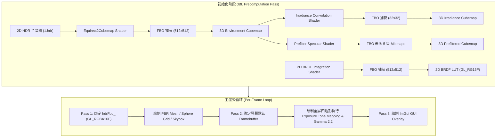

# OpenGL PBR Renderer (物理渲染与 IBL 预计算)

基于 OpenGL 4.3 核心模式实现的物理光照渲染器 (PBR Renderer)，从 Vulkan PBR 实现移植而来。包含 Cook-Torrance 光照模型、图像环境光照 (Image-Based Lighting, IBL) Split-Sum 离屏预计算管线、后处理色调映射 (HDR Tone Mapping) 以及交互式 ImGui 控制面板。

---

## 目录
- [功能特性](#功能特性)
- [渲染管线与 Pass 架构](#渲染管线与-pass-架构)
- [关键 OpenGL 状态管理](#关键-opengl-状态管理)
- [交互与控制按键](#交互与控制按键)
- [技术文档入口](#技术文档入口)

---

## 功能特性

1. **Cook-Torrance PBR 物理光照模型**
   - **法线分布函数 (NDF)**：Trowbridge-Reitz GGX
   - **几何遮蔽函数 (Geometry)**：Smith Schlick-GGX 遮蔽与掩蔽
   - **菲涅尔公式 (Fresnel)**：Fresnel-Schlick 近似（包含基础反射率 $F_0$ 绝缘体 0.04 与金属度插值）
   - **正交切线空间法线映射 (TBN Matrix)**

2. **IBL 图像环境光照 (Split-Sum 近似离屏预计算)**
   - **HDR 全景图转 Cubemap**：加载 2D 矩形全景 `.hdr` 图像并离屏渲染导出 512x512 3D 环境立方体贴图
   - **漫反射辐照度卷积 (Irradiance Cubemap)**：采用半球黎曼和积分，离屏生成 32x32 漫反射 Cubemap
   - **镜面反射预过滤 (Prefiltered Env Cubemap)**：采用 GGX 重要性采样，离屏导出 128x128 含 5 级 Mipmap 链的 Cubemap
   - **2D BRDF 积分查找表 (BRDF LUT)**：准蒙特卡洛积分（Hammersley 低差异点集与 Van Der Corput 位逆转），生成 512x512 `GL_RG16F` 2D 查找表

3. **模型与参数化测试场景**
   - **Damaged Helmet**：战损头盔模型（丰富 PBR 材质贴图：Albedo, Normal, Emissive, AO, Metallic, Roughness）
   - **Cerberus Gun**：科幻枪械模型（大面积金属与各向异性材质）
   - **7x7 Sphere Grid**：参数化球体阵列（横向变化 Metallic 金属度，纵向变化 Roughness 粗糙度）

4. **HDR 离屏 Pass 与 Tone Mapping 后处理**
   - 离屏 `GL_RGBA16F` 16 位浮点帧缓冲区 (HDR FBO)
   - 曝光度 (Exposure) 色调映射与 Gamma 2.2 校正
   - 支持 Reinhard / ACES Film / Uncharted2 色调映射算法切换

---

## 渲染管线与 Pass 架构

---

## 关键 OpenGL 状态管理

| 步骤 / 阶段 | Viewport 分辨率 | 绑定 Framebuffer | 绑定 Texture Slots (GL_TEXTUREn) | 关键 Depth / Culling 状态 |
|---|---|---|---|---|
| **Equirect2Cubemap Pass** | `512 x 512` | `captureFBO` (GL_DEPTH_ATTACHMENT) | Slot 0: `hdrTex` (GL_TEXTURE_2D) | `GL_DEPTH_TEST` 开启 |
| **Irradiance Convolution Pass** | `32 x 32` | `captureFBO` | Slot 0: `envCubemap` (GL_TEXTURE_CUBE_MAP) | `GL_DEPTH_TEST` 开启 |
| **Prefilter Mipmaps Pass** | `128x128` ~ `8x8` | `captureFBO` (Mip 附加) | Slot 0: `envCubemap` | `GL_DEPTH_TEST` 开启 |
| **2D BRDF LUT Pass** | `512 x 512` | `captureFBO` | 无输入纹理 (纯 Shader 积分) | `GL_DEPTH_TEST` 开启 |
| **Main Scene Pass (Pass 1)** | 窗口宽高 | `hdrFbo_` (GL_RGBA16F) | Slot 0: Prefilter Slot 1: Irradiance Slot 2: BRDF LUT Slot 3-8: Albedo, Normal, Emissive, AO, Metallic, Roughness | `glDepthMask(GL_TRUE)` `glDepthFunc(GL_LESS)` |
| **Skybox Render** | 窗口宽高 | `hdrFbo_` | Slot 0: `envCubemap` | `glDepthMask(GL_FALSE)` `glDepthFunc(GL_LEQUAL)` (`gl_Position.xyww` 优化) |
| **Post-Processing (Pass 2)** | 窗口宽高 | `0` (默认屏幕) | Slot 0: `hdrFbo_.getColorTexture()` | 绘制全屏 Quad |

---

## 交互与控制按键

- **鼠标左键 (LMB)**：按住并拖拽旋转 3D 相机 (Orbit Yaw / Pitch)
- **鼠标右键 / Shift + 左键**：按住并拖拽平移相机中心 (Pan Target)
- **鼠标滚轮 (Scroll)**：缩放相机视距 (Distance)
- **ImGui 控制面板**：
  - **Model Selection**：切换 Damaged Helmet / 7x7 Sphere Grid / Cerberus Gun
  - **Sphere Material Settings**：实时调整测试球体的基础颜色、金属度、粗糙度
  - **Lighting & Tone Mapping**：调节 IBL 强度、Exposure 曝光度、Gamma 系数及 Skybox 开关
  - **Camera Controls**：开启/关闭模型自动旋转，重置相机

---

## 技术文档入口

详见 `docs/` 目录下的深度解析文档：

- 📘 [PBR 原理与架构文档](docs/PBR_原理与架构.md)：Cook-Torrance 理论公式推导、IBL Split-Sum 近似推导与离屏状态机说明。
- 📙 [PBR Shader 与关键实现代码导读](docs/PBR_Shader与关键实现.md)：Shader 变量映射、准蒙特卡洛重要性采样代码导读与类设计说明。
